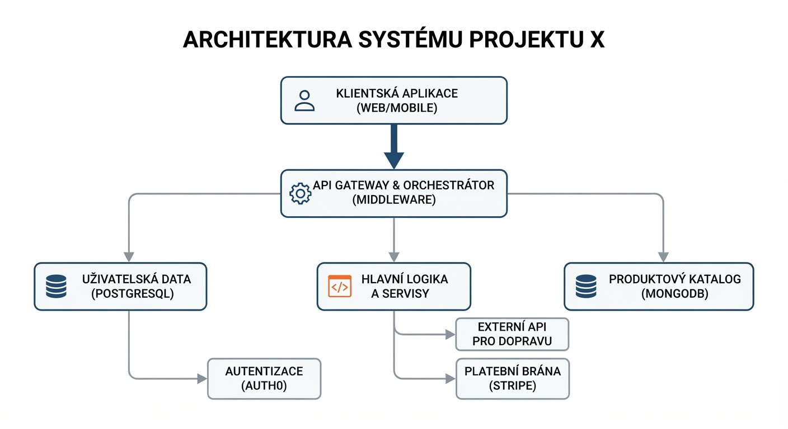
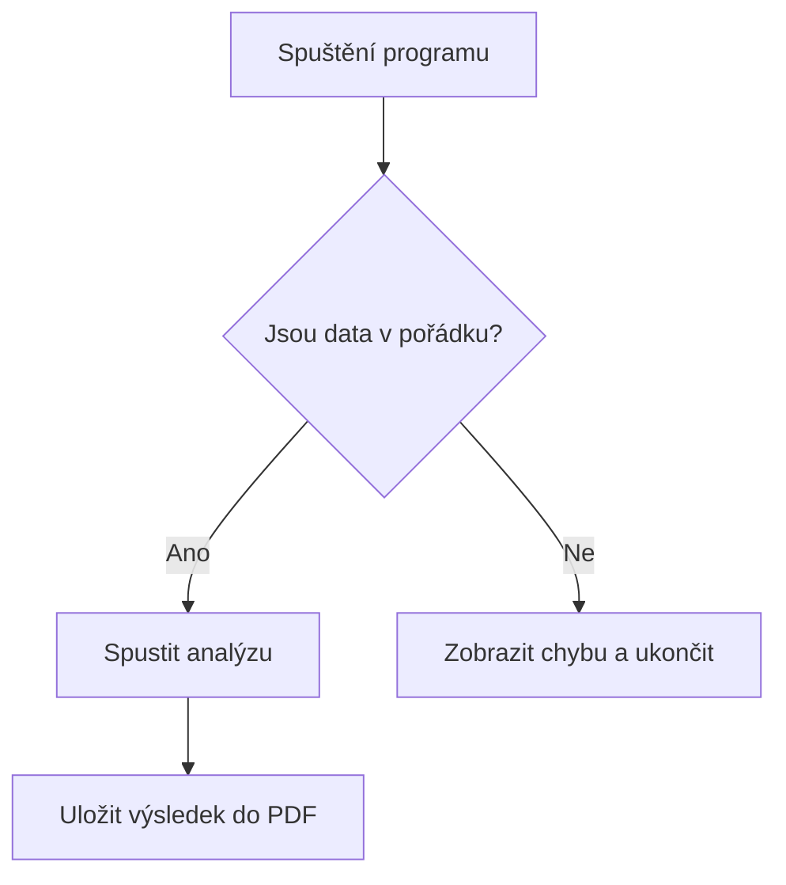

# Příběh Markdownu: Když text dostane křídla

Na počátku roku 2004 měli **John Gruber** a **Aaron Swartz** jasnou vizi: vytvořit způsob psaní pro web, který by byl stoprocentně čitelný v surovém stavu a zároveň se dal okamžitě převést do HTML. Chtěli se zbavit otravného psaní složitých značek jako `<p>`, `<strong>` nebo `<ul>`. Výsledkem byl **Markdown** – formát, který způsobil revoluci v tom, jak dnes píšeme texty na internetu.

Dnes je srdcem platforem jako GitHub, pohání moderní poznámkové systémy (Notion, Obsidian), formátuje zprávy v komunikačních aplikacích a stal se standardním jazykem pro komunikaci s umělou inteligencí. Jeho krása spočívá v tom, že vás neodvádí od psaní. Nemusíte sahat na myš, klikat na ikony formátování ani složitě nastavovat vzhled. Vše řídíte přímo při psaní písmen.

---

## Pět fascinujících nástrojů Markdownu v detailu

### 1. Architektura dokumentu pomocí Nadpisů
* **Jak se to dělá:** Struktura textu se v Markdownu řídí pomocí mřížek (`#`). Jedna mřížka představuje hlavní titulek, dvě mřížky podnadpis kapitoly a takto můžete klesat až do šesté úrovně. Klíčové je nezapomenout na **mezeru** mezi mřížkou a samotným textem. 

#### 📄 Před kompilací (Surový kód):
```markdown
# 👑 Kniha první: Cesta do neznáma
## Kapitola 1: Starý hostinec u cesty
### 1.1 Tajemný host v plášti
```

#### 🎨 Po kompilaci (Vyrenderovaný výsledek):
> # 👑 Kniha první: Cesta do neznáma
> ## Kapitola 1: Starý hostinec u cesty
> ### 1.1 Tajemný host v plášti

---

### 2. Emoce a důraz: Formátování textu
* **Jak se to dělá:** Chcete-li v textu vyjádřit ironii, cizí termín nebo vnitřní hlas, obalte slovo jednou hvězdičkou (`*`) pro kurzívu. Pro silný důraz nebo klíčové pojmy použijte dvojité hvězdičky (`**`). Styly můžete i kombinovat pomocí tří hvězdiček.

#### 📄 Před kompilací (Surový kód):
```markdown
Bylo to *naprosto neuvěřitelné*, ale ten starý stroj **stále fungoval**. 
Když se ozvalo ono slavné ***Cvak!***, všem v místnosti spadl kámen ze srdce.
```

#### 🎨 Po kompilaci (Vyrenderovaný výsledek):
> Bylo to *naprosto neuvěřitelné*, ale ten starý stroj **stále fungoval**. 
> Když se ozvalo ono slavné ***Cvak!***, všem v místnosti spadl kámen ze srdce.

---

### 3. Organizace myšlenek: Dynamické seznamy
* **Jak se to dělá:** Odrážky (nečíslované seznamy) vytvoříte pomocí pomlčky (`-`). Číslované seznamy tvoříte číslicí s tečkou. Skvělou funkcí jsou interaktivní úkolovníky (To-Do listy), které kombinují odrážku s hranatými závorkami `[ ]` pro prázdné políčko a `[x]` pro zaškrtnuté.

#### 📄 Před kompilací (Surový kód):
```markdown
- ⛺ Stan a teplý spacák
- 🍫 Dostatek čokolády

1. Probudit se před úsvitem.
2. Překontrolovat kompas.

- [x] Koupit letenky
- [ ] Sbalit batoh
```

#### 🎨 Po kompilaci (Vyrenderovaný výsledek):
> - ⛺ Stan a teplý spacák
> - 🍫 Dostatek čokolády
> 
> 1. Probudit se před úsvitem.
> 2. Překontrolovat kompas.
> 
> - [x] Koupit letenky
> - [ ] Sbalit batoh

---

---

### 4. Propojení světů: Odkazy a Obrázky
Tato sekce vám umožní propojit váš dokument s okolním internetem nebo do něj vložit vizuální materiály. V Markdownu se odkazy a obrázky píší téměř stejně, u obrázku stačí přidat pouze vykřičník na začátek.

* **a) Hypertextové odkazy:** Do hranatých závorek `[ ]` napíšete text, který má čtenář vidět, a do kulatých závorek `( )` bez jakékoliv mezery vložíte cílovou webovou adresu (URL).
* **b) Multimédia (Obrázky):** Začnete vykřičníkem `!`, do hranatých závorek `[ ]` napíšete alternativní popisek (důležitý pro vyhledávače nebo nevidomé) a do kulatých závorek `( )` vložíte cestu k obrázku. Pokud máte obrázek uložený přímo na GitHubu ve složce `images`, cesta bude začínat názvem této složky.

#### 📄 Před kompilací (Surový kód pro body 4a a 4b):
```markdown
Zde najdete [oficiální dokumentaci k Markdownu](https://github.com).

Níže je přiložené schéma našeho projektu:

```

#### 🎨 Po kompilaci (Vyrenderovaný výsledek):
> Zde najdete [oficiální dokumentaci k Markdownu](https://github.com).
> 
> Níže je přiložené schéma našeho projektu:
> 


---

### 5. Digitální laboratoř: Bloky kódu a zvýraznění syntaxe
* **Jak se to dělá:** Celý blok kódu shora i zdola ohraničíte třemi zpětnými apostrofy. Aby se kód barevně zvýraznil, hned za první tři apostrofy napíšete zkratku programovacího jazyka (např. `python` nebo `javascript`). *Poznámka: Samotný blok kódu už v sobě podbarvení a rámeček má automaticky zabudovaný od editoru, takže zde znak `>` nepoužíváme.*

#### 📄 Před kompilací (Surový kód):
````markdown
```python
def pozdrav():
    prumer = sum(hodnoty) / len(hodnoty)
    return f"Ahoj světe! {prumer}"
```
````

#### 🎨 Po kompilaci (Vyrenderovaný výsledek):
```python
def pozdrav():
    prumer = sum(hodnoty) / len(hodnoty)
    return f"Ahoj světe! {prumer}"
```

#### 📄 Před kompilací (Surový kód v C++):
````markdown
```cpp
#include <iostream>
#include <vector>

int main() {
    std::vector<int> cisla = {10, 20, 30};
    int suma = 0;

    for (int n : cisla) {
        suma += n;
    }

    std::cout << "Celkovy soucet je: " << suma << std::endl;
    return 0;
}
```
````

#### 🎨 Po kompilaci (Vyrenderovaný výsledek v C++):
```cpp
#include <iostream>
#include <vector>

int main() {
    std::vector<int> cisla = {10, 20, 30};
    int suma = 0;

    for (int n : cisla) {
        suma += n;
    }

    std::cout << "Celkovy soucet je: " << suma << std::endl;
    return 0;
}
```

---

## 🚀 Pokročilé speciality pro náročné

Moderní Markdown editory (jako Obsidian, Notion nebo GitHub) zvládají věci, které byste dříve museli složitě tvořit v grafických editorech nebo Excelu. Zde jsou nejzajímavější z nich:

### 6. Strukturovaná data: Tabulky
* **Jak se to dělá:** Tabulky se skládají pomocí svislítek (`|`) pro oddělení sloupců a pomlček (`-`) pro vytvoření čáry pod hlavičkou. Velkou výhodou je možnost zarovnání textu pomocí dvojteček: `:-` zarovná vlevo, `:-:` na střed a `-:` vpravo.

#### 📄 Před kompilací (Surový kód):
```markdown

| Jazyk / Prvek | Složitost | Hlavní využití | Rychlost | Stav na trhu |
| :--- | :---: | :--- | ---: | :---: |
| **Python** | Nízká | AI, Data Science, Skripty | Pomalý | 🔥 Extrémní růst |
| **C++** | Vysoká | Systémy, Hry, Výkon | Extrémní | 📈 Stabilní poptávka |
| **JavaScript** | Střední | Webové aplikace, Frontend | Rychlý | 🔝 Dominantní na webu |
| **TypeScript** | Střední | Velké webové projekty | Rychlý | 🚀 Rychlý nástup |
| **Rust** | Vysoká | Bezpečné systémové programování | Extrémní | 💎 Velmi žádaný |
| **SQL** | Nízká | Práce s databázemi, Analytika | Závisí na DB | 🏛️ Neochvějný základ |
| **Go (Golang)** | Střední | Cloud, Backend, Mikroslužby | Velmi rychlý | 🌐 Standard pro cloud |
```

#### 🎨 Po kompilaci (Vyrenderovaný výsledek):
> | Jazyk / Prvek | Složitost | Hlavní využití | Rychlost | Stav na trhu |
> | :--- | :---: | :--- | ---: | :---: |
> | **Python** | Nízká | AI, Data Science, Skripty | Pomalý | 🔥 Extrémní růst |
> | **C++** | Vysoká | Systémy, Hry, Výkon | Extrémní | 📈 Stabilní poptávka |
> | **JavaScript** | Střední | Webové aplikace, Frontend | Rychlý | 🔝 Dominantní na webu |
> | **TypeScript** | Střední | Velké webové projekty | Rychlý | 🚀 Rychlý nástup |
> | **Rust** | Vysoká | Bezpečné systémové programování | Extrémní | 💎 Velmi žádaný |
> | **SQL** | Nízká | Práce s databázemi, Analytika | Závisí na DB | 🏛️ Neochvějný základ |
> | **Go (Golang)** | Střední | Cloud, Backend, Mikroslužby | Velmi rychlý | 🌐 Standard pro cloud |
---

### 7. Vědecký zápis: Matematické rovnice (LaTeX)
* **Jak se to dělá:** Pokud potřebujete zapsat matematický nebo fyzikální vzorec, nejspolehlivější cestou pro GitHub je vložit ho do speciálního kódového bloku označeného slovem `math`. Všechny řecké symboly (jako lambda $\lambda$ nebo pí $\pi$) a mocniny se pak po uložení vykreslí v dokonalé grafické podobě.

#### 📄 Před kompilací (Surový kód):
````markdown
```math
G_{\mu\nu} + \Lambda g_{\mu\nu} = \frac{8\pi G}{c^4} T_{\mu\nu}
```
````

#### 🎨 Po kompilaci (Vyrenderovaný výsledek):
```math
G_{\mu\nu} + \Lambda g_{\mu\nu} = \frac{8\pi G}{c^4} T_{\mu\nu}
```

### 8. Vizuální schémata: Vývojové diagramy (Mermaid)
* **Jak se to dělá:** Místo kreslení v grafických programech můžete diagram jednoduše naprogramovat textem. Celý zápis vložíte do bloku kódu, kterému jako jazyk nastavíte `mermaid`. Editor z textové logiky sám vygeneruje čistý vektorový graf. Zkratka `TD` (Top-Down) v kódu určuje, že graf se bude vykreslovat shora dolů.

#### 📄 Před kompilací (Surový kód):
````markdown

````

#### 🎨 Po kompilaci (Vyrenderovaný výsledek):

